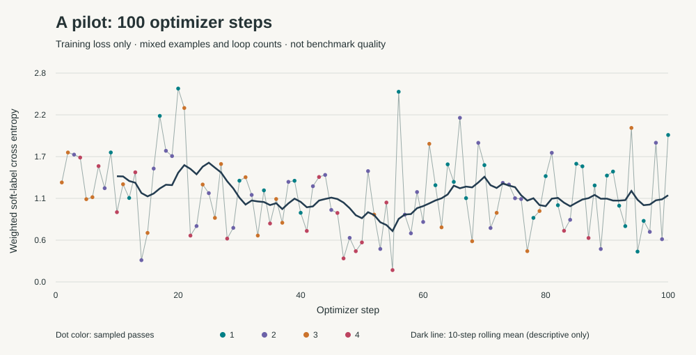

# A pilot — 100 optimizer steps

**A real training pilot, not a completed A stage or a benchmark result.**

- Pinned pretrained Ouro-1.4B; BF16; A100 SXM 80 GB.
- Rank-64 LoRA + embedding-initialized external head; base weights frozen.
- 100 AdamW steps, four sampled examples per accumulated batch, seed 238, learning rate 1e-4. Sampling is with replacement; this is not one epoch of the 29,995-example training pool.
- K sampled uniformly from 1–4 per batch; pass losses weighted proportional to pass number.
- Recorded training-loop duration through step 100: **278.11 seconds**, excluding setup/model load/checkpoint export. This is not serving latency or a fair runtime comparison.
- Weights remain on the private RunPod checkpoint volume. `checkpoint.json` here is **metadata only**; no model publication is authorized by this pilot.
- SST5 excluded pending license clarification. ARC restricted to a noncommercial research pilot because original distribution terms conflict with HF metadata. See `../../docs/data-sources.md`.

The batches contain different examples and different pass counts. The rolling mean is descriptive only and does not establish convergence or improved decision quality.

## Calibration outcome: tolerance failed after refit

Calibration used the separate 1,587-example grouped holdout. **These fitted-set diagnostics are not independent evaluation.**

- Full four-pass argmax accuracy: **69.69%**.
- Selected stopping policy before refit: **68.75%**, 2.92 mean passes. Drop: 0.945 percentage points, within 1 allowed.
- Same threshold after the prescribed one-time temperature refit: **68.24%**, 2.79 mean passes. Drop: **1.449 percentage points**, outside tolerance.
- Threshold remains frozen at 0.7070324327. No second threshold search was used to disguise the failure.
- `calibration.json` records `meets_1pp_after_refit: false`. **Do not promote this pilot as a qualifying adaptive model.** Temperature refitting changes the stopping population again; full training and calibration-policy review remain necessary.

Mean passes are not measured latency; there is no speedup claim. DecisionBench/BBH have only been processed in a quarantined input-hashing process; no benchmark evaluation or JevBench scoring has occurred.

The completion-triggered watchdog deleted the GPU after artifacts were persisted. Raw trajectories/targets and real weights stay on the private RunPod volume; only summary diagnostics are published.
